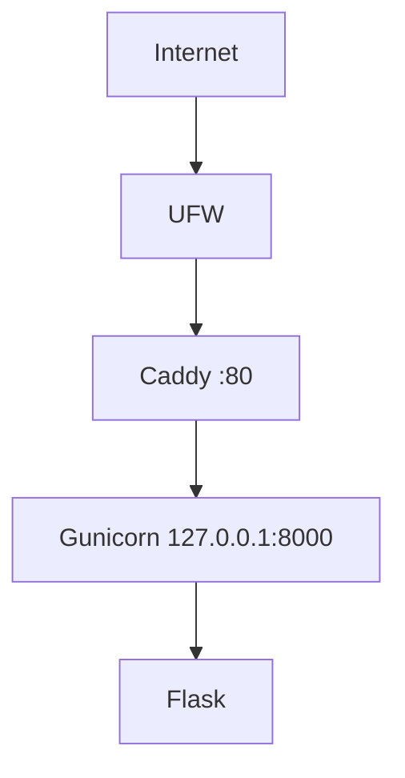

# Architecture v0.1

## Deployment View

## Resource Constraints
- Acuan modul: 1 vCPU, 1 GB RAM, 20 GB disk
- VPS aktual: 2 vCPU, 2 GB RAM, 20 GB disk, 1 GB swap
- Gunicorn dikonfigurasi 1 worker dan 2 thread (konservatif, mengikuti batas modul)

## Security Decisions
- non-root administration
- SSH key authentication
- password SSH disabled
- root login disabled
- UFW enabled (hanya SSH dan HTTP)
- backend loopback-only

## Current Limitations
- HTTP only
- single VPS
- no database
- no container
- no CI/CD

## Planned Evolution
- M04 DNS + HTTPS
- M05 persistent data
- M06 container
- M07 IaC
- M09 CI/CD
